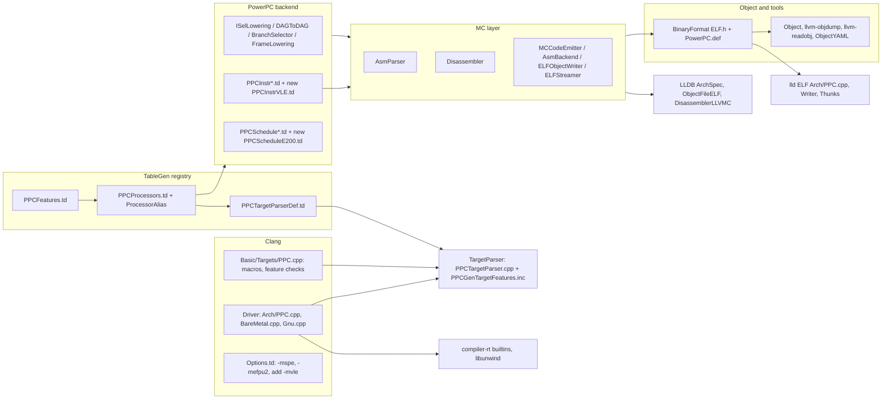
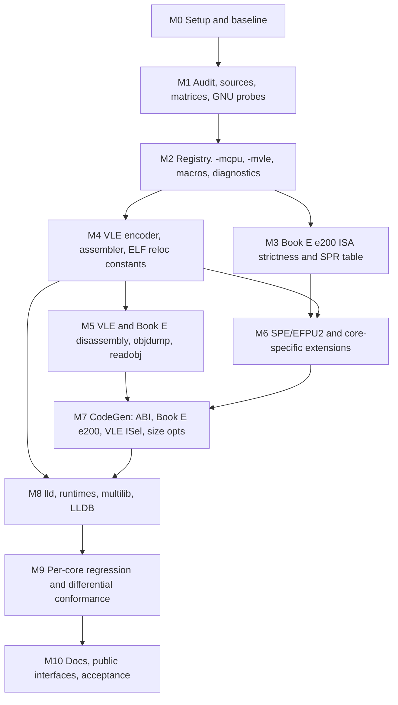

# PowerPC e200 Family and VLE Toolchain: Implementation Plan (LLVM fork)

## 0. Decisions in force

- **Repository:** upstream LLVM monorepo fork (`origin` = `git@github.com:dapperfu/llvm-project.git`), pinned at base `24b1941da3f6` (no upstream sync).
- **Branch:** `ppc-e200-vle`, pushed to `origin` after every commit.
- **Code style:** LLVM Coding Standards govern all in-tree C++/TableGen/lit code.
  - The `.cursor` git, plan, safety, and debugger rules apply in full.
  - The `.cursor` C++ style rules (snake_case, 120 cols, MISRA, custom logger, Makefile) do not apply in-tree.
- **Commits:** one instruction form or family per commit (`.td` plus its tests, under the test/tightly-coupled exceptions).
  - Format per `git/commit-format.mdc`, with an LLVM-style `[PowerPC]`/`[Clang]`/`[lld]` subject tag.
  - Every change list contains a `- Source:` bullet citing manual, revision, section/table, and page.
  - Pure LLVM-infrastructure commits say `- Source: none (LLVM infrastructure)`.
  - No `Requirements:` section (no StrictDoc/doorstop).
- **Git identity (repo-local):** `user.name "jed | Cursor.sh | Claude Opus 5.5"`, `user.email "jed@$(hostname).local"`.
- **Build checkpoint:** every ~25 commits and at each milestone end (Section 7).
- **Triples and modes:**
  - Triple `powerpc-unknown-eabi` only.
  - Book E encoding by default; `-mvle` opts in.
  - VLE-only cores (z0/z0h) force VLE and reject `-mno-vle`.
- **Undocumented implementation IDs are omitted from `-mcpu`.** These are e200z2/z210n3/z215An3/z225n3/z225Bn3, z410n3, z410Dn3, z420n3, z4201n3, z4204n3, z425n3, z4251n3, z425Bn3, z710n3, z720n3, z7260n3.
- **Lockstep checker variants** (z409, z419, z424, z709, z719, z758) are documented as non-programmable and never become targets.
  - The manuals only describe lockstep cross-signalling and the `p_lkstep_en` input (z4 RM p.763-798; z760 RM p.416, p.475).
- **In scope beyond compiler/assembler/disassembler/linker:** Clang BareMetal multilib, compiler-rt builtins, libunwind, and LLDB. Not in scope: llvm-mca tests and an ISA simulator.
- **References:** `reference/` and `S32DS/` stay untracked (`.git/info/exclude`); the source register records SHA-256 hashes.
- **Differential reference:** NXP `powerpc-eabivle` GCC 4.9.4 (build 1607) and binutils 2.28 in `S32DS/build_tools/powerpc-eabivle-4_9`.
  - These are i386 static binaries and run only outside the sandbox.
  - Their patches (`patches_applied/`) are consult-only (GPL): facts only, no code copied.
- **Real-world corpus:** `/projects/DEVKIT-Makefile` (MPC5744P/MPC5748G, VLE `.S` with `.section ...,"axv"`), used out-of-tree only.

## 1. Repository audit (deliverable A)



### Reusable components that exist today

- **CPU registry**
  - [llvm/lib/Target/PowerPC/PPCFeatures.td](llvm/lib/Target/PowerPC/PPCFeatures.td) and [llvm/lib/Target/PowerPC/PPCProcessors.td](llvm/lib/Target/PowerPC/PPCProcessors.td) already feed both the backend and the TargetParser via [llvm/lib/Target/PowerPC/PPCTargetParserDef.td](llvm/lib/Target/PowerPC/PPCTargetParserDef.td) (`-gen-target-features`). This is the central registry to extend.
  - `ProcessorAlias` is supported by `SubtargetEmitter` (backend) but not by `TargetFeaturesEmitter` (TargetParser).
- **Existing features:** `FeatureBookE`, `FeatureMSYNC`, `FeatureISEL`, `FeatureSPE` (implies `FeatureHardFloat`), `FeatureEFPU2` (implies SPE; f32-only), `FeatureICBT`, and the `PPC::DIR_*` directives.
- **SPE stack:** about 256 SPE defs in [llvm/lib/Target/PowerPC/PPCInstrSPE.td](llvm/lib/Target/PowerPC/PPCInstrSPE.td) (DecoderNamespace `SPE`).
  - Registers: `SPERC` 64-bit GPR model (S0-S31 = R + H halves).
  - ABI: SPE f64 in GPR pairs (`CC_PPC32_SPE_*`).
  - Scheduling: e500 itineraries cover SPE.
- **Disassembler:** separate decoder namespaces chosen by feature in [llvm/lib/Target/PowerPC/Disassembler/PPCDisassembler.cpp](llvm/lib/Target/PowerPC/Disassembler/PPCDisassembler.cpp); this is the pattern for a VLE namespace.
- **Analogs to reuse:**
  - RISC-V `Size = 2` formats, length from the first halfword, and `CompressInstEmitter`/`CompressPat`.
  - ARM per-section mode switching and llvm-objdump dual-subtarget disassembly.
  - RISC-V/ARM `calcEFlags` in lld.
  - RISC-V `SearchableTable` system-operand tables.
- **Clang:**
  - `BareMetal` already handles `powerpc*-unknown-eabi`.
  - `-mcpu=help` / `--print-supported-cpus` are generic.
  - `handleTargetFeaturesGroup` maps `-m<feat>` to `+<feat>` automatically.
  - `init-ppc.c` and `target-invalid-cpu-note/powerpc.c` test patterns.
- **lld:** full ppc32 target (REL24 thunks, TLS, secure PLT).

### Gaps, technical debt, and placeholders

- **MC layer:**
  - No 16-bit instructions anywhere.
  - `MinInstAlignment = 4`.
  - `writeNopData` emits only `0x60000000`.
  - No MC relaxation.
  - No `@sdarel`/`@sda21` specifiers.
  - `getFixupKindInfo` omits `fixup_ppc_half16dq` (latent off-by-one).
- **ELF and objects:**
  - No `SHF_PPC_VLE`, `PF_PPC_VLE`, `R_PPC_VLE_*`, `R_PPC_EMB_*`, `EF_PPC_*` for ppc32, or `.PPC.EMB.apuinfo`.
  - `ELFObjectFile::getFeatures()` returns nothing for EM_PPC, and `tryGetCPUName` returns `"future"`.
- **Assembler:** the `.machine` directive is a no-op (FIXME).
- **Instruction gating:**
  - `FeatureE500` is defined but attached to no processor, so `RFDI`/`RFMCI`/external-PID instructions are unreachable without `-mattr=+e500`.
  - `MFDCR`/`MTDCR` are gated by `IsPPC4xx` only.
  - `DCBA`, `LSWI`/`STSWI`, `MFPMR`/`MTPMR`, and `WAIT` are ungated.
- **SPE/ABI coupling:** `FeatureSPE` conflates instruction availability with the hard-float ABI. This blocks NXP's default (soft-float ABI with SPE instructions usable from asm).
- **No embedded ABI:** stack alignment is fixed at 16 (the EABI uses 8). r13 is reserved but there is no SDA lowering.
- **Clang:**
  - No e200 CPUs, no `-mvle`.
  - `getPPCAsmModeForCPU` passes `-many` to GNU as for everything.
  - `--print-enabled-extensions` exists only for AArch64/RISC-V.
  - Multilib flag generation has no PPC support.
- **Runtimes:** libunwind has no SPE upper-half or VLE assembly; LLDB has no ppc32 cores and no VLE address class.
- **Tests:** llvm-mca has none; exegesis is ppc64le-only.

### Integration risks

- TableGen decoder conflicts between VLE-reused primary opcodes and Book E.
- ISel pattern leakage (Book E patterns firing in VLE mode).
- Per-section STI switching in the asm parser and objdump.
- lld segment splitting for `PF_PPC_VLE`.
- Regressions in existing e500/440 behavior when predicates are tightened (mitigated by permissive-unless-strict predicates; see Section 4).

## 2. Source register (summary; full YAML in M1)

The authoritative documents below are all local in `reference/`. Implementation status for each is tracked in `plans/e200/source-register.yaml`.

- **Foundational architecture:**
  - IBM PowerPC Book I UISA v2.01 (09/2003)
  - Book II VEA v2.01 (12/2003)
  - Book III OEA v2.01 (12/2003)
  - IBM PEM 64/32 v2.0 (06/2003)
  - IBM Enhanced PowerPC Architecture Book E v1.0 (05/2002)
  - `BOOK_EUM.pdf` (Book E, 05/2002; exact ID and revision to read from the cover in M1)
- **Programmer's references:**
  - EREF 2.0 `EREF_RM` Rev. 0 (09/2011; covers the e200 family)
  - VLEPEM Rev. 0 (07/2007; Table B-2 by mnemonic, Table B-3 by opcode; 135 `e_`/`se_` mnemonics)
  - VLEPIM Rev. 1 (2/2006). Ch.2 ABI covers:
    - `SHF_PPC_VLE` = `PF_PPC_VLE` = `0x10000000`
    - APUinfo note: type 2, name `APUinfo`, VLE = `0x0104` rev 1
    - `R_PPC_VLE_REL8`..`R_PPC_VLE_SDAREL_HA16D` = 216..232
    - Field kinds bdh8/15/24, split16a/d, low21/split20
    - VLE and Book E code must be in separate output sections
    - App. A lists the simplified mnemonics.
  - SPEPEM Rev. 0 (01/2008)
- **Core manuals:**
  - e200z0CORERM Rev. 0 (4/2008; z0 and z0h)
  - e200z1RM Rev. 0 (09/2008)
  - ST UM0434 Rev 2 (11/2013; e200z3)
  - e200z4RM Rev. 0 (10/2009; e200z446n3)
  - e200z6RM Rev. 0 (6/2004, PRELIMINARY)
  - e200z759n3CRM Rev. 2 (01/2015)
  - e200z760RM Rev. 2 (06/2012)
- **Rejected:** `938fc5db...pdf` is a saved "Request blocked" HTML page, not a manual.
- **Missing (accessibility = unavailable):**
  - SPEPIM, SPE2PIM
  - PowerPC EABI (1995) and e500 ABI UG (E500ABIUG), which VLEPIM defers to
  - AN4802, an e200z2 manual, an e200z6 VLE addendum, and the VLE v1.01-to-v1.03 delta
- **Reference implementations (consult-only):**
  - NXP powerpc-eabivle GCC 4.9.4 build 1607 and binutils 2.28 binaries. Patches: `gcc.vle_494`, `gcc.vle_LSP_49x`, `gcc.vle_spe2`, `bin.2-28-*`, `gdb.7-8-2-vle*`.
  - The gcc submodule (`alfedotov/gcc`). Its `gcc-4.9.4-vle` branch is identical to upstream `gcc-4_9_4-release` (no VLE); it is useful only for upstream EABI conventions (`sysv4.h`, `eabi.h`).
  - DEVKIT-Makefile corpus; LLVM in-tree code.
  - QEMU is not installed and is not used.

### NXP facts already extracted (to be confirmed by M1 probes)

- **CPUs:** `-mcpu=` e200z0, e200z2, e200z3, e200z4, e200z6, e200z7, all with `POWERPC_E200_MASK = ISEL|VLE` and soft-float by default.
- **Options:** `-mvle`, `-mlsp`, `-mspe2`.
- **Macros:** `__VLE__`, `__PPCVLE__`, `__PPCE200Z{0,2,3,4,6,7}__`, `__PPC_EABI__`.
- **ASM spec:** e200z4 maps to `-me200z4 -mvle` (or `-mspe -mno-vle`).
- **Multilib:** `mcpu=e200z2..z7 / mhard-float / mspe / mno-vle`, with dirnames `e200zN fp spe booke`.
- **Inline-asm constraints:** `kregs`, `kareg`, `kcreg`, `kcrxx`, `kli20`, `kmsd4`, `kmmd8`, `koim5`, `kone1`, `ksci8`, `kscp8`, `kscI8`.
- **VLE code placement:** in `.section ".text","axv"`.

## 3. Processor capability matrix (deliverable B; summary; YAML in M1)

Values are supported, unsupported, or unverified. Citations are PDF pages of each core manual. Unverified is never enabled.

- **e200z0 / e200z0h** (e200z0CORERM Rev.0)
  - ISA and encoding: Book E v2.0, VLE-only (VLE v1.01). Classic encodings are unsupported (p.23, p.55).
  - Registers: 32-bit GPRs. SPE, EFP, FPU, MMU, and caches are unsupported. No timers and no IVORs.
  - Instructions:
    - `isel`, `se_rfdi`, and `wait` are supported.
    - String instructions, `mfdcr`/`mtdcr`, and TLB instructions are unsupported.
    - Cache and cache-lock instructions are no-ops; `dcbz` raises an alignment exception.
  - Interrupts: IVPR plus fixed offsets.
  - Pipeline: single-issue, 4 stages. z0h adds a 1-entry BTB, split buses, and NMI (ISA identical).
- **e200z1** (e200z1RM Rev.0)
  - ISA and encoding: Book E plus VLE v1.01.
  - Registers: 32-bit GPRs. SPE and EFP unsupported.
  - MMU and cache: 8-entry TLB (MAS0-4, MAS6); no cache.
  - Instructions: `isel`, Debug APU, `wait`, and `mfdcr`/`mtdcr` supported.
  - Interrupts: fixed-offset vectors.
  - Pipeline: single-issue, 4 stages.
- **e200z3** (UM0434 Rev 2)
  - ISA and encoding: Book E plus VLE.
  - Registers: 64-bit GPRs.
  - SPE and FP:
    - SPE is supported (version unstated); low-word fractional multiply forms are unsupported.
    - EFS scalar and vector single precision are supported. `efd*` is unsupported.
    - The 4 extra FMA instructions (`efs[n]madd`/`msub`) are unverified: no encodings are given.
  - Instructions: `wait`, `se_rfmci`, and `e_lmv*` unsupported.
  - MMU and cache: 16-entry TLB; no cache.
  - Interrupts: IVOR-based.
  - Pipeline: single-issue.
- **e200z446n3**, generic alias `e200z4` (e200z4RM Rev.0)
  - ISA and encoding: Book E plus VLE.
  - Registers: 64-bit GPRs.
  - SPE and FP:
    - SPE v1.1 and EFPU2 (77 mnemonics: `efsmax`/`efsmin`/`efsmadd`/`efsmsub`/`efsnmadd`/`efsnmsub`/`efssqrt`/`efscfh`/`efscth`/`evfsmax`/...; Tables 6-16/6-17, p.318-321).
    - `efd*` unsupported. MSR[SPE] gates only `evfs*`.
  - Instructions:
    - `e_lmv*`/`e_stmv*` volatile context save/restore (VLE pages only).
    - `rfmci` (Book E pages) and `se_rfmci` (VLE pages).
    - `dnh` (Book E) and `e_dnh`/`se_dnh` (VLE).
    - `wait`; `lbarx`/`lharx`/`stbcx.`/`sthcx.`.
  - Debug: IAC1-8, DVC1-2.
  - MMU and cache: 16-entry TLB; 4 KB instruction cache.
  - Pipeline: dual-issue, 5 stages.
- **e200z6** (e200z6RM Rev.0, preliminary)
  - ISA and encoding: Book E. VLE is unverified (never mentioned; no MAS2 VLE bit) and is not enabled.
  - Registers: 64-bit GPRs.
  - SPE and FP: SPE (version unstated) with EFS single precision.
  - Instructions: `mfdcr`/`mtdcr` unsupported; `wait` unverified.
  - MMU and cache: 32-entry TLB; 32 KB unified cache.
  - Pipeline: single-issue, 7 stages.
- **e200z759n3**, aliases `e200z759` and `e200z7` (CRM Rev.2)
  - ISA and encoding: PowerISA 2.06 embedded, Book E plus VLE v1.03.
  - SPE and FP: SPE 1.1 and EFPU2 (same opcodes as z4). `efd*` raises illegal-instruction.
  - Instructions: performance monitor (`mfpmr`/`mtpmr`, IVOR35).
  - MMU and cache: 32-entry TLB; 16 KB instruction plus 16 KB data cache.
  - Pipeline: dual-issue, 10 stages.
- **e200z760n3**, alias `e200z760` (RM Rev.2)
  - Same as z759n3, except SPE 2.1. The SPE2 encodings are unresolved, so it is registered with SPE 1.1 only.
  - MMU: 64-entry TLB.
  - Errata notes (p.784-785) go into the scheduler/codegen notes.
- **Generic family defaults:**
  - `e200z7` resolves to `e200z759n3`, the documented intersection of z759n3 and z760n3 (every z759n3 feature is in z760n3; SPE2 excluded).
  - `e200z4` resolves to `e200z446n3`, the only documented z4.
- **Per-core SPR differences** (drives the SPR table):
  - SPR 568 is ALTCTXCR on z1/z6 but IAC8 on z4/z759/z760.
  - IVORs are absent on z0/z1.
  - DVC exists only on z4/z759/z760.

## 4. Architecture design (deliverable D)

### 4.1 Registry and feature model (TableGen is the single source of truth)

- **Processors:** in [PPCProcessors.td](llvm/lib/Target/PowerPC/PPCProcessors.td).
  - New `ProcessorModel`s: `e200z0`, `e200z0h`, `e200z1`, `e200z3`, `e200z446n3`, `e200z6`, `e200z759n3`, `e200z760n3`.
  - `ProcessorAlias`es: `e200z4`, `e200z7`, `e200z759`, `e200z760`.
  - Each definition carries a comment citing the manual ID, revision, and pages.
- **Separation of concepts:** family = marker feature; implementation = ProcessorModel; chip configuration = multilib/driver; silicon revision = errata-only notes (no feature bits unless the manual defines an ISA difference).
- **New features** in [PPCFeatures.td](llvm/lib/Target/PowerPC/PPCFeatures.td). Final names are fixed in an M2 design commit.
  - **Family markers:** `FeatureE200` and `FeatureE200Z0`..`Z7`.
    - They have no codegen effect.
    - They drive macros and diagnostics through the generated feature table, so no CPU-name switches are needed.
  - **Capability vs. mode, in the ARM `thumb2`/`thumb-mode` style:**
    - `vle-isa`: the core implements the VLE category.
    - `vle`: encode/emit VLE; `-mvle` maps to it automatically. It requires `vle-isa` (diagnosed, never implied).
    - `vle-only`: implies `vle-isa` and `vle`.
  - **SPE split:**
    - New `spe-isa` (instructions assemblable). Existing `spe` (codegen/ABI) implies it, so the change is backward compatible.
    - `spe-fp-single` (EFS/EVFS without `efd*`).
    - Existing `efpu2` implies `spe-fp-single`, and new `efpu2-ext` covers the v2-only instructions.
  - **Category features** (EREF/Power ISA category names): `debug-apu` (`rfdi`), `mcheck-apu` (`rfmci`/MCSRR), `wait`, `dnh`, `vle-volatile-ctx` (`e_lmv*`), `dcr`, `booke-mmu`, `move-assist`, `perfmon`, `partword-atomics` (exists).
- **Strictness without regressions:**
  - New predicate pattern: `(any_of (not FeatureStrictISACategories), FeatureX)`.
  - Existing processors stay permissive. e200 processors imply `strict-isa-categories` and get exact per-category acceptance.
  - This separates mechanism (the strict flag) from policy (per-CPU category lists).
- **Directives:** `DIR_E200` plus tuning-only directives for heuristic hooks.
- **TargetParser:**
  - Add the CPUs to [PPCTargetParser.def](llvm/include/llvm/TargetParser/PPCTargetParser.def) (`BUILTIN_PPC_UNSUPPORTED`).
  - Extend `TargetFeaturesEmitter` to emit `ProcessorAlias` entries (infrastructure change). `normalizeCPUName` and `fillValidCPUList` then come from generated data.
  - Add a unit test asserting that TargetParser and backend CPU/alias/feature sets agree.
- **Programmatic inspection:**
  - `-mcpu=help` and `--print-supported-cpus` (existing).
  - Extend `--print-enabled-extensions` / `--print-supported-extensions` to PowerPC using the generated feature KV table (descriptions included).
  - `llvm-tblgen -dump-json` export, plus `plans/e200/capability-matrix.yaml`.

### 4.2 Clang and driver

- **[clang/lib/Basic/Targets/PPC.cpp](clang/lib/Basic/Targets/PPC.cpp) validation** in `initFeatureMap`/`handleTargetFeatures`, with new diagnostics in `DiagnosticDriverKinds.td`/`DiagnosticCommonKinds.td`:
  - `-mvle` without `vle-isa`
  - `-mno-vle` on a VLE-only core
  - VLE on `ppcle`
  - `-mspe` on z0/z1
  - `-mhard-float` on z0/z1
  - `-mspe2`/`-mlsp` give an "undocumented extension, not supported" error
- **Macros**, generated from features:
  - Existing: `__SPE__`, `__NO_FPRS__`, `_SOFT_FLOAT`/`_SOFT_DOUBLE`.
  - NXP-compatible: `__VLE__`, `__PPCVLE__`, `__PPCE200Z<n>__` (adds Z1), `__PPC_EABI__` on EABI.
  - New: `__PPC_E200__`, `__PPC_VLE__`.
  - Exact GCC parity confirmed by `gcc -dM -E` diffs in M1.
- **Float ABI** stays separate from ISA: e200 defaults to soft-float (NXP parity). `-mhard-float` on z3/z4/z6/z7 maps to `+efpu2`/`+spe-fp-single` (f32 hardware, f64 soft), as in the NXP `fp` multilib.
- **Data types:** long double is 64-bit IEEE for e200 EABI, if confirmed by an NXP `sizeof` probe.
- **Driver:** `-mvle`/`-mno-vle` in [Options.td](clang/include/clang/Options/Options.td) (`m_ppc_Features_Group`).
  - Under `-fno-integrated-as`, `Gnu.cpp` passes NXP's `ASM_CPU_SPEC` mapping (`-me200z4`, `-mvle`, `-mspe`).
  - [BareMetal.cpp](clang/lib/Driver/ToolChains/BareMetal.cpp) / `ToolChain::getMultilibFlags` gain PPC flags (CPU family, vle, float ABI, spe).
  - A sample `multilib.yaml` mirrors NXP's layout.
- **`-march`** is unsupported for PowerPC in this repo; documented, not added. `-mtune` already only sets `tune-cpu`; e200 entries go in `fillValidTuneCPUList`.

### 4.3 Assembler and instruction database

- **Database:** TableGen `.td` is the single encoding source, shared by matcher, encoder, decoder, and printer.
  - New [PPCInstrFormatsVLE.td](llvm/lib/Target/PowerPC/PPCInstrFormatsVLE.td): 16-bit `IVLE16` (`bits<16> Inst; Size = 2`).
  - 16-bit forms: BD8, C, IM5, OIM5, IM7, R, RR, SD4.
  - 32-bit forms: BD15, BD24, D8, I16A, I16L, M, SCI8, LI20, plus D/X forms (VLEPEM App. A).
  - New [PPCInstrVLE.td](llvm/lib/Target/PowerPC/PPCInstrVLE.td), DecoderNamespace `VLE` (tables `VLE16` and `VLE32`).
- **Shared Book E instructions** (VLEPEM Table B-2, identical opcode-31/EVX encodings) get a TSFlags bit `PPCII::VLEValid`. In VLE mode, the asm matcher (`checkTargetMatchPredicate`) rejects anything that is neither VLE-specific nor `VLEValid`, citing Table B-2.
- **Operands:**
  - Register classes `GPRVLE16` (r0-r7, r24-r31) and `GPRVLEAlt` (r8-r23).
  - `CRRC0_3` for VLE branches and compares (VLEPEM 2.3.1.1).
  - Immediates: SCI8 (UI8 x SCL plus F fill, with encodable-value predicate), OIM5 (1..32), UI5/UI7, SD4 scaled by access size, D8, split I16A/I16L, LI20, BD8/15/24.
  - Each operand has range checks and a diagnostic.
- **Mode switching:** section-driven, as in VLEPIM 2.2.
  - `.section name,"...v"` sets `SHF_PPC_VLE`; entering such a section switches available features to `vle` (allowed only if `vle-isa`).
  - `-mvle` marks default text sections VLE.
  - `.vle`/`.novle`/`.machine` are implemented only if the M1 GNU probe proves they exist.
  - `.machine` push/pop is upgraded from a no-op to real feature switching, matching the GNU semantics observed.
- **SPR names:** new `PPCSystemOperands.td` (`SearchableTable`, RISC-V CSR style) holding name, number, privilege, required features, and per-core alias.
  - It resolves the SPR 568 conflict and drives `mfspr`/`mtspr` name parsing and optional named printing.
- **Aliases:** VLEPIM App. A simplified mnemonics as `InstAlias`. No silent substitution of user-written forms (for example, `R_PPC_VLE_SDA21` `e_add16i` to `e_li` rewriting happens only in the linker, per VLEPIM Table 2-5).
- **Fixups and specifiers:**
  - New fixups: `fixup_ppc_vle_bd8`, `bd15`, `bd24`, `split16a`, `split16d`, `sda21` (low21/split20).
  - Specifiers `@sdarel`, `@sda21`; `@l`/`@h`/`@ha` map to the A/D split variants by operand kind.
- **Nops and alignment:**
  - VLE-aware `writeNopData`: `se_nop` 2-byte, `e_nop` 4-byte (encodings from VLEPEM).
  - Instruction alignment 2 in VLE sections; branch range and parity checks.
- **Relaxation:** no assembler relaxation of user-written branches by default, unless the GNU probe shows binutils 2.28 relaxes. Compiler-side branch selection handles range.

### 4.4 Disassembler and object tools

- **Disassembler:** `getInstruction` in VLE mode:
  - Reads a big-endian halfword (VLE is BE-only; VLEPEM 2.2.3).
  - Classifies length by primary opcode per a table derived from VLEPEM Table B-3, exhaustively verified against NXP objdump.
  - Tries `VLE16`/`VLE32`, then the shared opcode-31/SPE tables with a post-decode `VLEValid` check.
  - Unknown or reserved encodings become `<unknown>`.
- **llvm-objdump:** per-section subtarget selection by `SHF_PPC_VLE` (ARM dual-STI pattern).
  - `ELFObjectFile::getFeatures()` for EM_PPC derives `+spe-isa`/`+vle-isa`/... from `.PPC.EMB.apuinfo` and VLE sections, without changing the default for plain objects.
  - `-M no-aliases` uses the existing `PrintAliases`.
- **llvm-readobj and ObjectYAML:** names for `SHF_PPC_VLE`, `PF_PPC_VLE`, `EF_PPC_EMB` (if confirmed), and apuinfo note decoding.

### 4.5 CodeGen

- **Book E e200 (z1/z3/z4/z6/z7 without `-mvle`):** existing ppc32 SVR4 path, plus:
  - an EABI ABI profile (8-byte stack alignment, from GCC `sysv4.h` `ABI_STACK_BOUNDARY`, reference-derived);
  - soft/EFPU2 float lowering;
  - new scheduling models.
- **VLE ISel:**
  - VLE patterns carry `Predicates = [IsVLEMode]`; Book E-only patterns get `NotVLEMode`.
  - A `PPCInstrInfo::verifyInstruction` check rejects any non-`VLEValid` MachineInstr in VLE functions, as a machine-verifier safety net.
  - The MC emitter errors (not asserts) if a Book E-only encoding reaches a VLE section.
- **Constants:** `e_li` (LI20), `e_lis`, `e_or2i`/`e_or2is`, SCI8 immediates for `e_addi`/`e_andi`/`e_ori`/`e_xori`/`e_mulli`/`e_subfic`.
- **Memory:** `e_lwz`/`e_stw` D-form, D8 update forms, shared X-form indexed.
- **Control flow:**
  - Branches `e_b`/`e_bc` (CR0-3 only), `se_b`/`se_bc` (CR0).
  - `PPCBranchSelector` extended with VLE sizes and ranges (bd8 ±256 B, bd15 ±32 KB, bd24 ±16 MB).
  - Calls `e_bl`/`se_bl`/`se_bctrl`; returns `se_blr`; long calls via `e_lis`/`e_or2i`/`se_mtctr`.
- **Frame lowering:** VLE prologue/epilogue (`e_stwu`, `se_mflr`, `e_stmw`/`e_lmw` under `-Os`).
- **Code size:** `e_*` to `se_*` compression through `CompressPat` and `-gen-compress-inst-emitter`, applied to compiler output only.
  - Register-allocation hints toward `GPRVLE16` under `-Os`/`-Oz`.
  - Cost hooks prefer 16-bit forms.
- **Mixed mode:** a per-function `+vle` attribute places VLE functions in VLE-flagged sections. The section name is fixed by the M1 probe (NXP uses `.text,"axv"`).
  - Cross-mode calls force 4-byte alignment for VLE functions reachable from Book E `bl` (VLE text is 2-byte aligned).
- **Atomics:** `lwarx`/`stwcx.` (shared), `lbarx`/`lharx` on z4/z7, `msync`/`mbar` MO validation (z4/z759/z760: MO 0-2).
- **SPE/EFPU2 lowering:** reuse existing; add `efssqrt`, `efsmax`/`efsmin` (IEEE semantics checked against EFPU2 docs before mapping to `fmaxnum`), `efsmadd` family (fused vs. unfused verified before mapping to FMA).
- **Inline asm:** NXP constraints (`kregs`, `kareg`, `kcreg`, `ksci8`, `kli20`, ...) in Clang `validateAsmConstraint` and backend `getConstraintType`.
- **SDA:** `-msdata=eabi|sysv|none`, `-G n`; r13 `.sdata`/`.sbss`, r2 `.sdata2`; `@sda21`/`@sdarel` relocations.
- **Scheduling:** `PPCScheduleE200.td` with machine models from documented latency tables (z0 Table 4-2, z1 Table 4-2, z3 Table 158, z4 Tables 4-3/4-4, z6 Table 7-1, z759 Table 24, z760 Table 4-3).
  - Labeled approximate. No cycle-accuracy claims, no llvm-mca tests.

### 4.6 ELF, lld, runtimes, LLDB

- **[ELF.h](llvm/include/llvm/BinaryFormat/ELF.h):**
  - `SHF_PPC_VLE`, `PF_PPC_VLE` (VLEPIM 2.2.2).
  - apuinfo constants (VLE 0x0104 from VLEPIM; others reference-derived).
  - `EF_PPC_EMB` (reference-derived).
- **[PowerPC.def](llvm/include/llvm/BinaryFormat/ELFRelocs/PowerPC.def):** `R_PPC_VLE_*` 216-232 (VLEPIM Table 2-4); `R_PPC_EMB_*` and `R_PPC_SDAREL16` from probe evidence.
- **lld [Arch/PPC.cpp](lld/ELF/Arch/PPC.cpp):**
  - Relocations: all VLE field kinds, including SDA21 low21/split20 with the base register (13/2/0) chosen by section (VLEPIM Table 2-5); `_SDA_BASE_`/`_SDA2_BASE_` symbols.
  - Overflow and halfword-parity diagnostics.
- **lld layout and compatibility:**
  - VLE and non-VLE executable input sections must not mix in one output section (error).
  - A new PT_LOAD starts when the VLE flag changes; `PF_PPC_VLE` is set, and placing non-VLE sections in a VLE segment is an error.
  - apuinfo merge with highest revision per ID (optional revision-bump warning, VLEPIM 2.2.1).
  - `.gnu.attributes` FP-ABI mismatch errors.
  - Errors for REL24 to 2-byte-aligned VLE targets.
  - A VLE long-branch thunk.
- **compiler-rt builtins:** generic C, cross-built per multilib via a new CMake cache `clang/cmake/caches/PPC-e200-baremetal.cmake`.
- **libunwind:**
  - `__VLE__` variants of `UnwindRegistersSave.S`/`Restore.S`.
  - `__SPE__` 64-bit GPR save/restore (`evstdd`/`evldd`).
  - DWARF numbers for SPE upper halves checked against NXP GCC CFI.
- **LLDB:**
  - `ArchSpec` cores `eCore_ppc_e200*`.
  - `ObjectFileELF` maps `SHF_PPC_VLE` sections to `AddressClass::eCodeAlternateISA`.
  - `DisassemblerLLVMC` uses a VLE STI.
  - VLE 2-byte software breakpoint opcode from the NXP gdb patch (reference-derived).
  - Registers come via gdb-remote target XML, so no new ppc32 RegisterContext class is needed.

### 4.7 Testing strategy

- **Per instruction** (lit, `llvm-mc --show-encoding` + `--disassemble`): exact bytes, canonical text, and a round-trip RUN (`llvm-mc -filetype=obj | llvm-objdump -d` reassembled, then byte compare).
  - Boundary tests for every operand class: min, max, min-1, max+1, misaligned displacement, and restricted registers.
- **Per-core negative suites:** each core runs the full e200 ISA file and must reject exactly the instructions outside its category set.
- **CodeGen:** `-O0`/`-O1`/`-O2`/`-O3`/`-Os`/`-Oz` runs for arithmetic, control flow, recursion, aggregates, varargs, inline asm, SPE/EFPU2, VLE, and mixed mode.
  - A curated subset of existing ppc32 CodeGen tests reruns with `-mattr=+vle -verify-machineinstrs` (no FileCheck) to prove no Book E leakage.
- **Differential** (`cross-project-tests/ppc-e200-differential/`, lit feature `nxp-eabivle`, path from `NXP_EABIVLE_TOOLCHAIN`):
  - Compares encodings, symbols, relocations, section/segment flags, apuinfo, and macros against NXP `as`/`objdump`/`readelf`/`gcc -dM -E`.
  - Disagreements are filed in `plans/e200/discrepancies.md`, not auto-resolved.
- **Coverage gates** are computed by `plans/e200/tools/` (out-of-tree Python following the .cursor Python rules: uv venv, click, ruff), comparing `llvm-tblgen -dump-json` against `instruction-inventory.yaml`:
  - 100% of in-scope documented encodings have encoding, disassembly, and round-trip tests.
  - 100% of VLEPIM App. A aliases.
  - 100% of `R_PPC_VLE_*` emitted (MC) and applied (lld), with overflow tests.
  - Every operand class has its 4 boundary tests.
  - Every core has its negative suite.

### 4.8 Proposed new and changed paths

- `plans/ppc-e200-vle-toolchain.md`
- `plans/e200/{audit.md, source-register.yaml, capability-matrix.yaml, instruction-inventory.yaml, gnu-behavior.md, discrepancies.md, tools/}`
- `llvm/lib/Target/PowerPC/`
  - New: `PPCInstrFormatsVLE.td`, `PPCInstrVLE.td`, `PPCSystemOperands.td`, `PPCScheduleE200.td`
  - Modified: `PPCFeatures.td`, `PPCProcessors.td`, `PPCTargetParserDef.td`, `PPCRegisterInfo.td`, `PPCInstrInfo.td`, `PPCInstrSPE.td`, `PPC.td`, `CMakeLists.txt`, ISel/Frame/BranchSelector/AsmPrinter/InstrInfo `.cpp`, plus the `AsmParser/`, `Disassembler/`, and `MCTargetDesc/` directories
- `llvm/include/llvm/BinaryFormat/`, `llvm/lib/Object/`, `llvm/lib/ObjectYAML/`, `llvm/tools/llvm-objdump/`, `llvm/tools/llvm-readobj/`
- `llvm/utils/TableGen/Basic/TargetFeaturesEmitter.cpp`
- `llvm/lib/TargetParser/`, `llvm/include/llvm/TargetParser/`
- `clang/lib/Basic/Targets/PPC.*`, `clang/lib/Driver/ToolChains/{Arch/PPC.cpp, BareMetal.cpp, Gnu.cpp}`, `clang/lib/Driver/ToolChain.cpp`, `clang/include/clang/Options/Options.td`, `clang/include/clang/Basic/Diagnostic*Kinds.td`, `clang/tools/driver/cc1_main.cpp`
- `lld/ELF/{Arch/PPC.cpp, Writer.cpp, Thunks.cpp, SyntheticSections.*}`
- `libunwind/src/{Registers.hpp, UnwindRegistersSave.S, UnwindRegistersRestore.S}`
- `lldb/source/Utility/ArchSpec.cpp`, `lldb/source/Plugins/ObjectFile/ELF/`, `lldb/source/Plugins/Disassembler/LLVMC/`
- Tests:
  - `llvm/test/MC/PowerPC/{e200,vle}/`, `llvm/test/MC/Disassembler/PowerPC/vle/`
  - `llvm/test/CodeGen/PowerPC/{e200,vle}/`
  - `llvm/test/tools/llvm-{objdump,readobj}/ELF/PowerPC/`
  - `lld/test/ELF/ppc32-vle-*.s`
  - `clang/test/{Driver,Preprocessor,CodeGen/PowerPC}/*e200*`
  - `llvm/unittests/TargetParser/`, `lldb/unittests/`
- Docs: `llvm/docs/PowerPCE200.md`

## 5. Instruction coverage matrix (deliverable C)

- **Schema** of `plans/e200/instruction-inventory.yaml` (one record per encoding):
  - Identity: `id`, `mnemonic`, `aliases`, `form`
  - Encoding: `opcode_hex`, `mask_hex`, `width` (16/32)
  - Operands: `operands` (name, type, bitfield, range, scale, register restriction)
  - Rules: `constraints`, `required_features`, `mode` (vle | booke | both), `privilege` (P/O/M/none, VLEPEM Table B-1)
  - Per-core availability: `cores` (z0, z0h, z1, z3, z446n3, z6, z759n3, z760n3: supported/unsupported/unverified)
  - Linkage: `relocations`, `sources` (doc, table, page), `llvm_record`
  - Status: `impl_status`, `tests` (enc/dis/roundtrip/neg)
- **Seed sources:**
  - VLEPEM Table B-2 (VLE plus shared Book E; 135 `e_`/`se_` mnemonics)
  - EREF instruction tables
  - SPEPEM (about 283 SPE/EFP mnemonics; LLVM has about 256 defs)
  - e200 core-manual tables (z0 Tables 3-1/3-2; z1 3-1..3-4; z3 Tables 100-112; z4 3-1/3-2/3-4/6-16/6-17; z6 3-1; z759 Table 18; z760 Ch.3/5)
- **Unverified rows are not implemented or enabled:** SPE2 (z760), z3 FMA extras, z6 VLE, LSP.

## 6. Milestones (deliverables E, F)

Each milestone lists its files, tasks, dependencies, tests, verification, exit criteria, and risks. Verification for every milestone also includes the checkpoint commands in Section 7.



- **M0. Setup** (no manual citations; infrastructure)
  - Tasks:
    - Save this plan to `plans/` (first commit).
    - Create the branch and set the git identity.
    - Commit the staged `.cursor/rules` submodule plus `.gitignore`, then the `gcc` submodule (separate atomic commits).
    - Add `reference/` and `S32DS/` to `.git/info/exclude`.
    - Configure the build (Section 7) and record baseline `check-llvm`/`check-clang`/`check-lld` results to `plans/e200/baseline.md`.
  - Exit: the baseline is recorded and pushed.
- **M1. Audit and documentation**
  - Files: `plans/e200/*`.
  - Tasks:
    - Write `audit.md` (Section 1 expanded with file:line).
    - Write `source-register.yaml` with SHA-256 hashes.
    - Write `capability-matrix.yaml` with per-field citations.
    - Seed `instruction-inventory.yaml` from the tables above.
  - **GNU probe suite** (out-of-tree scripts running NXP binaries), recorded in `gnu-behavior.md`:
    - `.vle`/`.novle`/`.machine` existence and semantics
    - effect of `-mvle` on plain `.text`
    - mixed mnemonic acceptance
    - `e_flags`, apuinfo emission
    - `R_PPC_EMB_*` numbers, `@sda21` syntax
    - VLE nop bytes, relaxation policy, SPR-name operands
    - objdump `-M vle`
    - `gcc -dM -E` macros per CPU and float ABI
    - `sizeof(long double)` and stack alignment
    - SPE DWARF register numbers
    - section names for mixed modules
    - the empirical 16/32-bit length map over all 64K first halfwords
  - Tests: inventory schema validation runs in the tools' own tests.
  - Exit:
    - Every matrix cell is supported, unsupported, or unverified, with a citation.
    - Every unresolved item appears in Section 8.
  - Risks: NXP binaries need unsandboxed execution.
- **M2. Registry and target selection**
  - Files: PPCFeatures/PPCProcessors/PPCTargetParserDef `.td`, TargetFeaturesEmitter, PPCTargetParser, Clang Basic/Driver/Options/Diagnostics, `cc1_main.cpp`, PPCSubtarget.
  - Tasks:
    - Features, processors, aliases (Section 4.1).
    - Subtarget validation: `vle` without `vle-isa` is a hard error; VLE codegen reports "not yet implemented" until M7 rather than silently emitting Book E.
    - Clang validation, macros, `-mvle`/`-mno-vle`, `--print-enabled-extensions` for PPC.
    - External-assembler flag mapping.
  - Tests:
    - `clang/test/Driver/ppc-e200-cpus.c`, `ppc-e200-vle.c`, `ppc-e200-diags.c`
    - `clang/test/Preprocessor/init-ppc-e200.c`
    - update `target-invalid-cpu-note/powerpc.c`
    - `llc -mcpu=help` test
    - TargetParser unit test (alias/feature agreement)
  - Exit:
    - All 8 canonical CPUs and 4 aliases work.
    - Omitted names give "unknown CPU" with the valid list.
    - Every invalid combination in Section 4.2 has a tested diagnostic.
    - No existing PPC test regresses.
- **M3. Book E e200 ISA completion and strictness**
  - Files: `PPCInstrInfo.td`, `PPCInstrSPE.td` (predicates only), new `PPCSystemOperands.td`, AsmParser/InstPrinter.
  - Tasks:
    - Category predicates (strict-for-e200).
    - Fix the `rfdi`/`rfmci` reachability for e200 via `debug-apu`/`mcheck-apu`.
    - `mfdcr`/`mtdcr` via `dcr`; TLB instructions via `booke-mmu`; string instructions via `move-assist`; `wait`, `dnh`, `mfpmr`/`mtpmr`; `mbar` MO validation.
    - SPR table with per-core names.
    - `.machine` with real feature switching (if the probe confirms).
  - Tests: `llvm/test/MC/PowerPC/e200/booke-<core>.s` (positive) and `booke-<core>-invalid.s` (negative); e500/440 tests unchanged.
  - Exit: the per-core Book E inventory rows are implemented and tested at 100%.
- **M4. VLE encoder and assembler** (dependency for disassembly, codegen, and lld)
  - Files: `PPCInstrFormatsVLE.td`, `PPCInstrVLE.td`, `PPCRegisterInfo.td`, MCTargetDesc (fixups, emitter, backend, ELF writer, streamer, MCAsmInfo), AsmParser, `PowerPC.def`, `ELF.h`.
  - Tasks, in commit order:
    1. Formats and operands.
    2. Instructions by form: BD8/BD15/BD24 branches, C, R, RR, IM5/OIM5/IM7, SD4, D, D8, I16A/I16L, SCI8, LI20, M, X.
    3. `VLEValid` flags on shared Book E instructions.
    4. Mode switching via section flags.
    5. Fixups and relocations, specifiers.
    6. VLE nops/alignment.
    7. Simplified mnemonics.
  - Tests: `llvm/test/MC/PowerPC/vle/<form>.s` (bytes plus boundaries), `vle-invalid-*.s`, `vle-relocs.s` (`llvm-readobj -r`), `vle-section-flags.s`.
  - Exit:
    - 100% of VLEPEM Table B-2 `e_`/`se_` rows assemble with exact bytes.
    - All `R_PPC_VLE_*` relocations are emitted.
    - Book E-only instructions are rejected in VLE sections.
  - Risks: matcher ambiguity, split-field fixup offsets.
- **M5. Disassembly**
  - Files: PPCDisassembler, `ELFObjectFile.cpp`, llvm-objdump, ELFDumper, ELFYAML.
  - Tasks: VLE length decode, VLE tables, shared-table filter, per-section STI in objdump, readobj flag and apuinfo printing, yaml2obj support.
  - Tests: `llvm/test/MC/Disassembler/PowerPC/vle/*.txt`, round-trip RUNs, `llvm-objdump` mixed-section test, `llvm-readobj` flags test.
  - Exit:
    - 100% round-trip for M3/M4 instructions.
    - The reserved/invalid halfword sweep matches the M1 length map.
- **M6. SPE, EFPU2, and core-specific extensions**
  - Tasks:
    - `spe-isa`/`spe-fp-single`/`efpu2-ext` split.
    - EFPU2 v2 instructions (z4 Tables 6-16/6-17).
    - Gate `efd*` off for e200.
    - z3/z6 SPE exclusions (low-word fractional forms).
    - `e_lmv*`/`e_stmv*` (z4 RM p.108-115).
    - `se_rfmci`, `e_dnh`/`se_dnh`, `lbarx` family; VLE-only and Book E-only restrictions.
  - Explicitly not implemented: SPE2, LSP, z3 FMA extras.
  - Tests: per-core encoding and negative suites; `-mattr=+efpu2` existing users re-verified.
  - Exit: the extension inventory rows are 100% covered.
- **M7. CodeGen and ABI**
  - Sub-milestones:
    - 7a: EABI profile (stack 8, long double, float ABI) for Book E e200; scheduling models.
    - 7b: VLE ISel, constants, memory, compares on CR0-3.
    - 7c: VLE branches and BranchSelector; calls, returns, jump tables, long calls.
    - 7d: VLE frame lowering.
    - 7e: compression and RA hints for `-Os`/`-Oz`.
    - 7f: SPE/EFPU2 lowering additions.
    - 7g: inline-asm constraints.
    - 7h: SDA (`-msdata`, `-G`).
    - 7i: mixed-mode functions and section placement.
  - Tests:
    - `llvm/test/CodeGen/PowerPC/vle/*.ll` and `e200/*.ll` at all `-O` levels.
    - `-verify-machineinstrs` VLE leakage suite.
    - Clang CodeGen tests for constraints and macros.
  - Exit:
    - No Book E-only instruction appears in any VLE test output (verifier plus MC error check).
    - Differential ABI probes (struct passing, varargs, f64 pairs) match NXP GCC.
  - Risks: pattern leakage, CR-field allocation limits, branch-range estimation with 2-byte instructions.
- **M8. ELF linking, runtimes, LLDB**
  - Tasks:
    - lld relocations, SDA bases, section/segment rules, apuinfo merge, attribute checks, VLE thunk.
    - CMake cache and multilib.yaml; compiler-rt builtins per multilib.
    - libunwind VLE/SPE.
    - LLDB ArchSpec, address class, VLE disassembly, breakpoint opcode.
  - Tests:
    - `lld/test/ELF/ppc32-vle-reloc*.s`, `-overflow.s`, `-mixed-section-error.s`, `-segment.s`, `-apuinfo.s`, `ppc32-sda21.s`.
    - libunwind compile tests for z0 and z4.
    - LLDB unit tests.
  - Exit:
    - Every relocation is applied and checked for overflow.
    - Incompatible objects are diagnosed.
    - DEVKIT Hello_World links with ld.lld, with section/segment flags matching NXP ld output.
- **M9. Conformance**
  - Tasks:
    - Coverage-gate tooling.
    - Per-core regression matrix (8 cores x {booke, vle} x float ABIs).
    - Differential suite over the instruction inventory and DEVKIT `.S` files.
    - Discrepancy triage.
  - Exit: all Section 4.7 gates pass; every discrepancy is either explained or fixed.
- **M10. Documentation and acceptance**
  - Tasks:
    - `llvm/docs/PowerPCE200.md`: user guide, options, macros, ABI, VLE sections, limitations, and "adding a new e200 variant" (registry, features, sched, SPR table, inventory, tests).
    - `ReleaseNotes.md` PowerPC section; Clang docs for `-mvle`.
    - Final full test runs.
  - Exit: the Section 9 criteria are satisfied, or explicitly listed as known limitations.

## 7. Build checkpoints and working procedure

- **Configure** (once):

```
cmake -S llvm -B build-e200 -G Ninja -DCMAKE_BUILD_TYPE=Release -DLLVM_ENABLE_ASSERTIONS=ON -DLLVM_ENABLE_PROJECTS="clang;lld;lldb" -DLLVM_TARGETS_TO_BUILD="PowerPC;X86" -DLLVM_CCACHE_BUILD=ON -DLLVM_USE_LINKER=lld -DCMAKE_C_COMPILER=clang -DCMAKE_CXX_COMPILER=clang++
```

- **Every ~25 commits:**

```
ninja -C build-e200 && ninja -C build-e200 check-llvm-mc-powerpc check-llvm-mc-disassembler-powerpc check-llvm-codegen-powerpc check-llvm-unit
build-e200/bin/llvm-lit -sv clang/test/Driver clang/test/Preprocessor --filter 'ppc|powerpc|baremetal'
build-e200/bin/llvm-lit -sv lld/test/ELF --filter ppc
```

- **Milestone end:** `ninja -C build-e200 check-llvm check-clang check-lld` (plus lldb unit tests from M8), compared against the M0 baseline. Any new failure blocks the milestone.
- **Debugging:** use `lldb`/`gdb` on a separate `build-e200-dbg` (Debug, no `-O3`), not print statements.
- **Shell safety:** no `sudo`, and no `!` in shell strings (including commit messages via `-F` file).
- **Commit template:**

```
[PowerPC] Add VLE SCI8-form arithmetic immediates

- Define e_addi/e_addic/e_subfic/e_mulli/e_andi/e_ori/e_xori (SCI8) in PPCInstrVLE.td
- Add SCI8 operand encoder/decoder and boundary/invalid MC tests
- Source: VLEPEM Rev. 0 (07/2007), App. A.16 SCI8 form; Table B-2 p. B-x

-----
Prompt: <execution prompt> (plan TODO <id>)
Context: <what the code does>
Justification: <why>

Technical details:
- Model: Claude Opus 5.5
- IDE: Cursor <version>
- Generation method: AI-assisted pair programming
- Code style: LLVM Coding Standards
- Dependencies: <key deps>
- Tokens: <estimate>
```

## 8. Unresolved questions (deliverable G)

Each item gives why it matters, what could resolve it, what proceeds independently, and what must not be speculated.

1. **e200z2.**
   - Why it matters: you stated it does not exist, but NXP GCC accepts `-mcpu=e200z2` (`__PPCE200Z2__`, `e200z2` multilib) and DEVKIT has `MPC5748G/e200z2_3`.
   - Resolved by: a z2 (z210n3) manual or AN4802.
   - Proceeds independently: everything else.
   - Not speculated: any z2 feature set; it stays omitted.
2. **MPC57xx implementations** (z4251n3, z4204n3, z425n3, ...).
   - Why it matters: DEVKIT's `-mcpu=e200z4` resolves to z446n3, so differences such as MMU vs. MPU, LSP, and cache could make the assembler accept instructions the real core lacks.
   - Resolved by: AN4802 and per-core RMs.
   - Proceeds independently: everything else.
   - Not speculated: z4251n3 features.
3. **SPE2 on z760n3.**
   - Why it matters: no SPE2PIM exists here, and the z760 RM lists mnemonics without opcodes.
   - Resolved by: SPE2PIM; or, with your explicit approval, facts from NXP `bin.2-28-spe2-binutils` (reference-derived, marked as such).
   - Not speculated: any SPE2 encodings.
4. **LSP.** No manual; NXP `-mlsp` exists. Same treatment as SPE2.
5. **e200z3 `efs[n]madd`/`efs[n]msub` encodings.** Absent from UM0434; may equal z4's 0x2C2/0x2C3/0x2CA/0x2CB but stay disabled on z3 until documented.
6. **e200z6 VLE.**
   - Why it matters: NXP GCC treats z6 as VLE-capable, but the 2004 RM does not.
   - Resolved by: the e200z6 VLE addendum.
   - Until then, `-mcpu=e200z6 -mvle` is an error.
7. **EABI and e500 ABI documents.**
   - These determine stack alignment, SDA conventions, `R_PPC_EMB_*` numbers, `EF_PPC_EMB`, `.gnu_attribute` values, long double size, and non-VLE apuinfo IDs.
   - Interim source: GCC `sysv4.h` plus NXP probe results, each marked reference-derived in the source register.
8. **VLE versions.** The v1.01 (z0/z1) vs. v1.03 (z759) delta is undocumented. VLEPEM Rev. 0 is treated as the baseline, and per-core manuals add extras.
9. **VLE default mode.** Your Book E default diverges from NXP GCC (VLE on by default for every e200 `-mcpu`). Documented as a migration note; reversible in the registry.
10. **`e200z7` alias target.** Resolves to z759n3 (the documented intersection); confirm this choice over z760n3.
11. **NXP `-mshort-double`** (`gcc.vle_short_double`): GCC-only ABI extension; not planned unless requested.

## 9. Completion criteria mapping

Your 12 final criteria are checked in M10 against:

- per-core lit suites (criteria 1-5)
- round-trip results (6)
- the VLE leakage verifier plus differential ABI probes (7)
- lld relocation and section tests (8)
- the single TableGen registry plus the alias-consistency unit test (9)
- coverage gates (10)
- `PowerPCE200.md` limitations (11)
- baseline comparison (12)

The criteria that cite `-mcpu=e200z2` and `-mcpu=e200z4251n3` are recorded as intentionally unmet under the omit-undocumented decision until Section 8 items 1-2 are resolved.